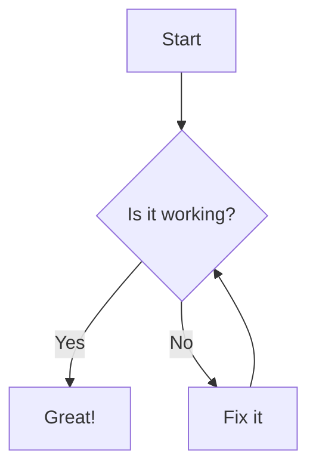
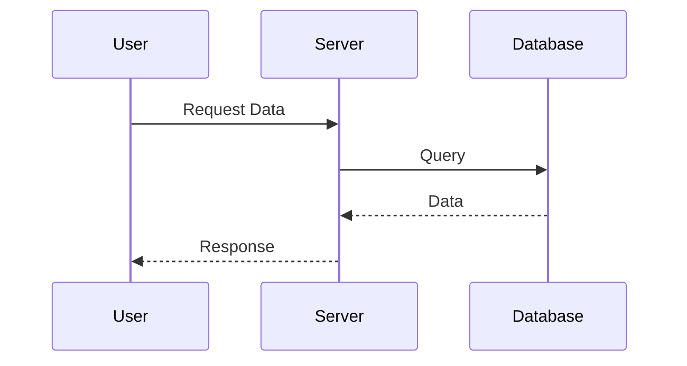
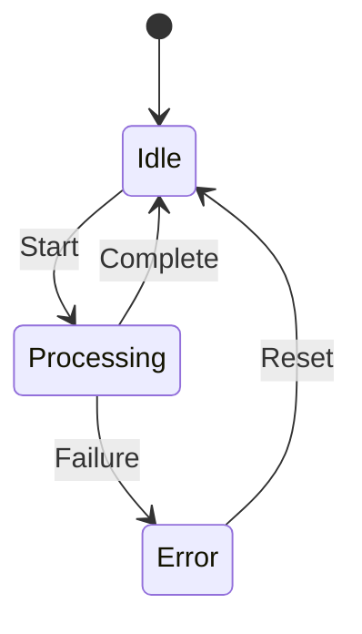
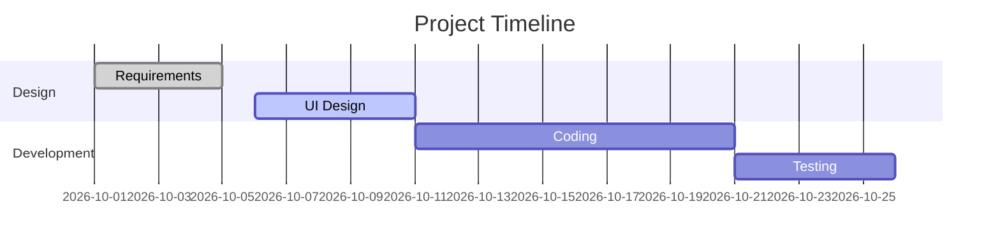

# Sample Markdown with Mermaid

This is a sample file to test the **Markdown & Mermaid Viewer**.

## 1. Basic Markdown
- **Bold text** and *italic text*
- [Links](https://example.com)
- `Inline code`

## 2. Mermaid Flowchart

## 3. Mermaid Sequence Diagram

## 4. Mermaid State Diagram

## 5. Mermaid Gantt Chart

